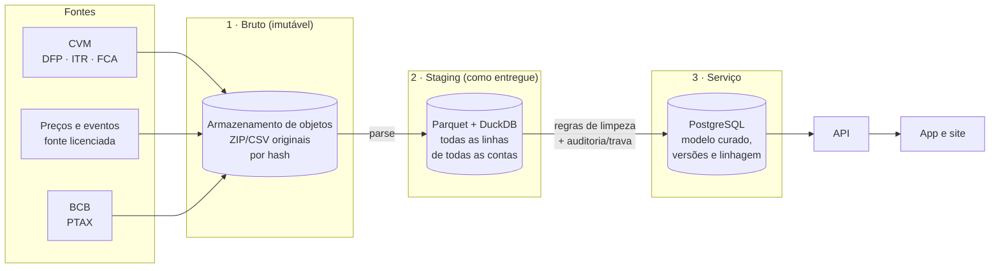
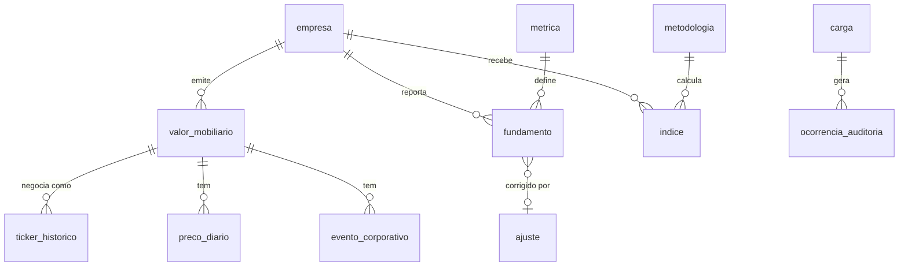
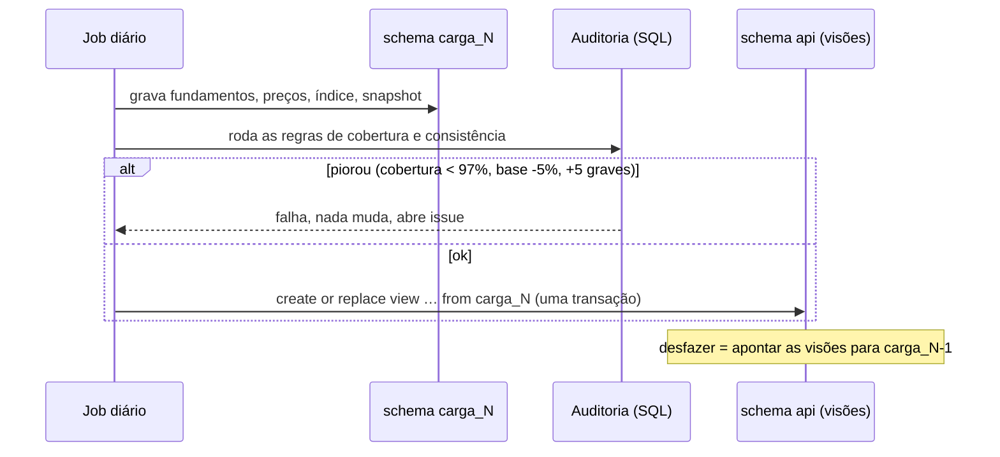
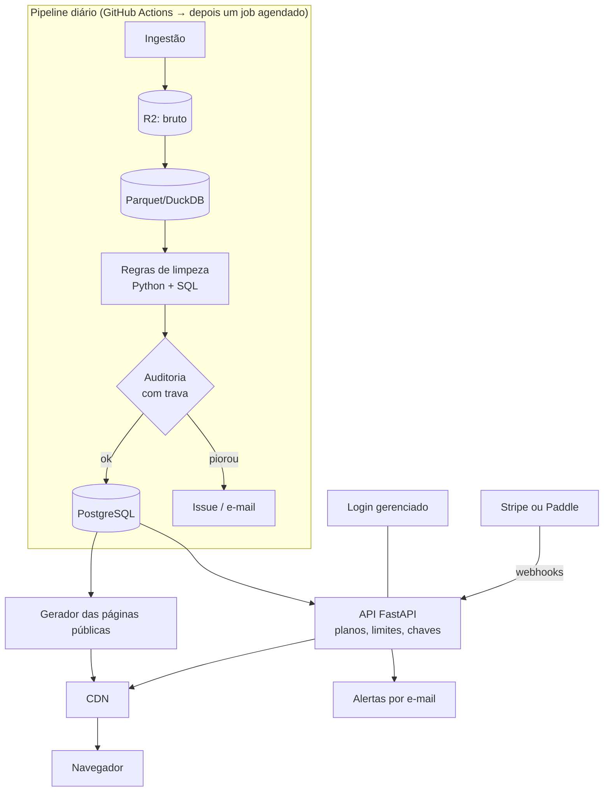

# Real Terms — arquitetura para vender acesso

> [!summary] Resumo
> - **O formato atual da base é o maior obstáculo.** Hoje, um único JSON de 1,5 MB com tudo é baixado por qualquer visitante. Não dá para cobrar por um dado que o navegador já recebe inteiro, e o arquivo não comporta séries trimestrais nem preços diários.
> - **Base recomendada, em três camadas:**
>   1. Arquivos brutos imutáveis em armazenamento de objetos.
>   2. *Staging* em Parquet/DuckDB, com as linhas da CVM exatamente como foram entregues.
>   3. **PostgreSQL** como base de serviço: valores em formato longo, versão do documento e data de conhecimento (*point-in-time*), linhagem até a linha da CVM e correções guardadas como dado.
> - **Entrega ao usuário:** site público estático (vitrine e SEO), gerado da base e só com uma amostra, mais um app com login que lê de uma API (FastAPI) com limites por plano. Cobrança via Stripe ou Paddle.
> - **Dois bloqueios não técnicos antes de cobrar:**
>   - **Licença de dados de mercado da B3.** Preço, valor de mercado, múltiplos, liquidez e proventos derivam dela.
>   - **Resolução CVM 20.** É preciso confirmar que o índice e o ranking não contam como análise de valores mobiliários.
> - **Primeiro passo:** a camada de dados (Fase 1). Ela não tem custo, não tem risco jurídico e é pré-requisito de todo o resto.

---

## 1. Ponto de partida (medido em 18/11/2026)

| Item | Hoje |
|---|---|
| Empresas | 345 (31 financeiras), 482 tickers |
| Séries | 28 contas × até 17 exercícios (média de 14,3), mais 12 meses (TTM) para 333 empresas |
| Pontos de série | 133 mil, sendo 8,4% nulos |
| Formato | `data/empresas.js`: um único `window.DADOS` com 1,5 MB (518 KB com gzip) |
| Preços | fechamento do fim de cada ano e o último pregão; sem série diária |
| Atualização | GitHub Actions em dia útil; processa, testa (40 testes), audita com trava e publica no Pages |

### O que o formato atual impede

| Limitação | Por que pesa num produto pago |
|---|---|
| Tudo num arquivo público | Qualquer um copia `window.DADOS`. Sem paywall possível, e quem paga não tem nada que o grátis não tenha. |
| Só anual + 12 meses; preço só de fim de ano | Quem paga quer trimestral, preço diário, preço ajustado e histórico de múltiplos. Do jeito atual, isso viraria um arquivo de dezenas de MB. |
| Arrays paralelos alinhados pela posição (`anos[k]` ↔ `series.x[k]`) | É frágil e não convive com períodos de tamanhos diferentes (ano, trimestre, 12 meses). |
| Cada execução sobrescreve tudo; só fica a maior `VERSAO` | Sem histórico de reapresentações, sem visão *point-in-time*, sem desfazer uma publicação ruim. |
| Correções aplicadas no próprio número (escala de ações, lucro zerado) | Não dá para mostrar "declarado × corrigido" nem explicar a origem de um número. A auditoria fica fora da base. |
| Empresas sem balanço recente saem da base | Viés de sobrevivência: qualquer backteste fica otimista. |
| Ticker como identidade | Ticker muda (incorporação, troca de código). Código CVM e ISIN são estáveis. |

### O que vale preservar

- **As regras de limpeza:** escala de ações, consolidado × individual, tickers pela B3, lucro zerado e as demais documentadas no README. Elas são o ativo mais difícil de copiar.
- **Auditoria com trava:** não publicar uma base pior que a anterior.
- **Testes, idiomas e atualização incremental das fontes.**

---

## 2. Requisitos e premissas

**Funcionais (o que justifica cobrar):**
- Histórico completo, anual e trimestral, com preço diário e ajustado.
- Screener com filtros e comparação (teia).
- Exportação para CSV/Excel, listas de acompanhamento e alertas por e-mail.
- Acesso por API num plano superior.
- **Explicar cada número:** de qual documento, versão e conta ele veio, e se foi corrigido.

**Não funcionais:**

| Dimensão | Premissa | Nota |
|---|---|---|
| Universo | ~350 empresas ativas + ~1.000 históricas | estimativa; as deslistadas entram para evitar viés de sobrevivência |
| Fundamentos curados | até ~5 mi de linhas (1.000 empresas × 85 períodos × ~60 métricas) | conta de ordem de grandeza |
| Preços diários | ~2–4 mi de linhas (≈500 tickers × 252 pregões × 17 anos, mais deslistados) | conta de ordem de grandeza |
| Staging CVM (todas as contas) | dezenas de milhões de linhas; centenas de MB a poucos GB em Parquet | estimativa, a medir na Fase 1 |
| Usuários pagantes no ano 1 | centenas a poucos milhares | premissa de negócio |
| Escrita | uma carga por dia, mais as entregas da CVM | leitura ≫ escrita |
| Latência | p95 < 300 ms por página/API | |
| Disponibilidade | 99,5% | sem tempo real, sem alta disponibilidade multirregião |
| Equipe | 1 pessoa, Python | custo fixo e operação mínimos |

**Conclusão:** o volume é pequeno e cabe com folga num único Postgres. O difícil aqui é **confiança e governança**: linhagem, versões, data de conhecimento e controle de acesso. Não precisa de infraestrutura de big data.

---

## 3. Formato da base de dados

### 3.1 Três camadas



**Camada 1: bruto.** O arquivo original de cada fonte fica num armazenamento de objetos (Cloudflare R2 ou S3), nomeado pelo hash do conteúdo e nunca apagado.
- Exemplo de caminho: `bruto/cvm/dfp/2025/<sha256>.zip`.
- A tabela `arquivo_fonte` registra fonte, URL, data do download, hash e tamanho.
- **Para que serve:** reproduzir qualquer dia passado. Hoje, quando a CVM regera um ZIP, a versão anterior se perde.

**Camada 2: staging.** As linhas das fontes como vieram, em Parquet particionado por fonte e ano, consultadas com DuckDB. **Todas as contas** de todas as demonstrações, não só as 28 de hoje, para criar métricas novas sem baixar nada de novo.

| Tabela | Grão | Campos principais |
|---|---|---|
| `cvm_linha` | uma conta de uma demonstração de um documento | `cd_cvm`, `cnpj`, `documento` (DFP/ITR), `demonstracao` (DRE, BPA, BPP, DFC_MD/MI, DVA, DMPL), `consolidado`, `dt_refer`, `dt_ini`, `dt_fim`, `ordem_exerc`, `versao`, `dt_receb`, `cd_conta`, `ds_conta`, `escala`, `vl_conta`, `arquivo_id` |
| `cvm_cadastro` | empresa × data do FCA | tickers, setor, segmento, controle, ADR |
| `negocio_diario` | ticker × pregão | ISIN (o COTAHIST já traz), abertura, máxima, mínima, fechamento, volume, negócios, fator de cotação |
| `ptax` | dia | compra, venda |

**Por que Parquet + DuckDB aqui:**
- O DuckDB lê CSV dentro de ZIP e roda dentro do GitHub Actions, sem servidor.
- As regras de limpeza podem migrar aos poucos de dicionários Python para SQL, que é mais fácil de testar e revisar.
- O formato colunar torna barato reprocessar 17 anos.

**Camada 3: serviço (PostgreSQL).** Modelo curado, que é o que a API e o site leem. Detalhes a seguir.

### 3.2 Modelo curado



```sql
-- Identidade: código CVM para a empresa, ISIN para o papel; ticker é atributo com validade
create table empresa (
  id            bigint generated always as identity primary key,
  cd_cvm        text unique not null,
  cnpj          text not null,
  nome          text not null,
  setor_cvm     text, setor_b3_pt text, setor_b3_en text,
  segmento      text, controle text,
  financeiro    boolean not null default false,
  situacao      text not null,              -- ativa | cancelada | suspensa
  deslistada_em date                        -- deslistadas ficam: sem viés de sobrevivência
);

create table valor_mobiliario (
  id         bigint generated always as identity primary key,
  empresa_id bigint not null references empresa,
  isin       text unique not null,
  classe     text not null                  -- ON | PN | PNA | PNB | UNT …
);

create table ticker_historico (
  valor_mobiliario_id bigint not null references valor_mobiliario,
  ticker              text not null,
  valido_de           date not null,
  valido_ate          date,                 -- null = vigente
  primary key (valor_mobiliario_id, valido_de)
);

-- Catálogo de métricas: guia a interface, as traduções e a regra de conversão para dólar
create table metrica (
  codigo     text primary key,              -- receita, lucro_controladora, divida_liquida…
  nome_pt    text not null, nome_en text not null,
  unidade    text not null,                 -- brl | brl_por_acao | acoes | razao
  natureza   text not null,                 -- fluxo (PTAX média) | saldo (PTAX do fim)
  descricao  text, regra text               -- como é localizada/derivada
);

-- Correções viram dado (hoje ficam escondidas dentro do número)
create table ajuste (
  id               bigint generated always as identity primary key,
  empresa_id       bigint not null references empresa,
  periodo_fim      date not null, metrica text not null,
  valor_declarado  numeric(24,4), valor_corrigido numeric(24,4),
  regra            text not null,           -- escala_acoes_x1000, lucro_controladora_zerado…
  explicacao_pt    text, explicacao_en text
);

-- Fundamentos em formato longo, append-only, bitemporal
create table fundamento (
  empresa_id   bigint not null references empresa,
  periodo_fim  date   not null,             -- tempo válido: a que período o número se refere
  tipo_periodo text   not null,             -- ano | tri | acum_ano | 12m
  metrica      text   not null references metrica,
  valor        numeric(24,4),               -- em reais (unidade), não em R$ mil
  base         text   not null,             -- consolidado | individual
  versao_doc   int    not null,
  conhecido_em timestamptz not null,        -- tempo de transação: entrega à CVM (DT_RECEB)
  origem       jsonb  not null,             -- {arquivo_id, demonstracao, cd_conta, ordem_exerc}
  ajuste_id    bigint references ajuste,    -- preenchido quando o valor foi corrigido
  primary key (empresa_id, periodo_fim, tipo_periodo, metrica, conhecido_em)
);

create table preco_diario (
  valor_mobiliario_id bigint not null references valor_mobiliario,
  data        date not null,
  abertura    numeric(14,4), maxima numeric(14,4), minima numeric(14,4), fechamento numeric(14,4),
  volume      numeric(20,2), negocios int,
  fonte       text not null,                -- troca de fornecedor sem mexer no resto
  primary key (valor_mobiliario_id, data)
);

create table evento_corporativo (
  id                  bigint generated always as identity primary key,
  valor_mobiliario_id bigint not null references valor_mobiliario,
  tipo           text not null,             -- dividendo | jcp | desdobramento | grupamento | bonificacao
  data_com       date, data_ex date, data_pagamento date,
  valor_por_acao numeric(18,8), fator numeric(18,8),
  fonte          text not null
);

create table acoes_em_circulacao (
  empresa_id bigint not null references empresa,
  data date not null, acoes_on bigint, acoes_pn bigint, tesouraria bigint, fonte text not null,
  primary key (empresa_id, data, fonte)
);

create table cambio (moeda text, data date, compra numeric(12,6), venda numeric(12,6), primary key (moeda, data));

-- Índice de previsibilidade com metodologia versionada: mudar pesos não reescreve o passado
create table metodologia (versao text primary key, pesos jsonb not null, descricao text, vigente_desde date not null);
create table indice (
  empresa_id   bigint not null references empresa,
  calculado_em date not null,
  moeda        text not null,               -- brl | usd
  metodologia  text not null references metodologia,
  total        smallint, componentes jsonb, janela int4range,
  primary key (empresa_id, calculado_em, moeda, metodologia)
);

-- Cargas e auditoria: a trava atual, agora com histórico consultável
create table carga (
  id bigint generated always as identity primary key,
  iniciada_em timestamptz not null, concluida_em timestamptz,
  status text not null, resumo jsonb             -- cobertura, empresas, graves…
);
create table ocorrencia_auditoria (
  carga_id bigint not null references carga, empresa_id bigint references empresa,
  regra text not null, severidade text not null, detalhe jsonb
);
```

**Visões derivadas (materializadas a cada carga):**
- `fundamento_atual`: a versão mais recente de cada número, que é o que a interface mostra por padrão.
- `fundamento_em(data)`: o que se sabia numa data, para backtestes sem olhar o futuro.
- `fundamento_largo`: uma coluna por métrica, uma linha por empresa × período. É o que a página da empresa e a exportação leem.
- `preco_ajustado`: o fechamento corrigido por desdobramentos, grupamentos e proventos. Resolve a limitação "preços sem ajuste" do README.
- `snapshot_diario`: preço, valor de mercado, P/L, P/VP, DY e EV/EBITDA por ticker e por dia. Dá o histórico diário de múltiplos e alimenta o screener e os alertas.

**Tabelas da aplicação:** `usuario` (id do provedor de login), `plano` (limites em `jsonb`), `assinatura` (ids do Stripe/Paddle, status, renovação), `lista`, `alerta`, `chave_api` (só o hash) e `uso_api`.

### 3.3 Decisões e trade-offs

**1. Formato longo no armazenamento, largo na leitura.**

| | Longo (`empresa, período, métrica, valor`) | Largo (uma coluna por métrica) |
|---|---|---|
| Nova métrica | uma linha no catálogo, sem migração | `alter table` e nova carga |
| Versão e linhagem por número | natural (cada linha tem a sua) | difícil (uma linha com 60 origens) |
| Leitura para tela e screener | precisa pivotar | direta e rápida |

**Escolha:** longo como fonte da verdade e `fundamento_largo` materializado depois de cada carga. Com ~5 mi de linhas, o refresh é rápido.

**2. Bitemporal "leve" (período + data de conhecimento).**
- Cada número tem o período a que se refere (`periodo_fim`) e o momento em que ficou público (`conhecido_em`). Esse momento é a data de recebimento do documento na CVM, que está no arquivo-índice de cada ZIP da DFP/ITR. Conferir o nome exato da coluna (`DT_RECEB`) na Fase 1.
- **Custo:** reapresentações viram linhas novas (são poucas), e as consultas usam a visão `fundamento_atual`.
- **Ganho:** o modo *point-in-time* separa dado profissional de dado amador. Um backteste que usa o balanço reapresentado em 2024 para decidir algo em 2022 olha o futuro sem querer.
- **Detalhe que muda:** hoje, quando o arquivo do próprio ano e a coluna comparativa do ano seguinte divergem, o código guarda só o do próprio ano. No modelo novo, os dois ficam, e a interface escolhe "como divulgado" ou "como reapresentado".

**3. Unidades.**
- **Valores monetários:** em reais (`numeric`), com a escala da CVM normalizada na entrada. Acaba a convenção "R$ mil" espalhada pelo código.
- **Por ação:** `numeric(18,8)`.
- **Preços:** `numeric(14,4)`, com o fator de cotação já aplicado.
- **Razões** (P/L, margens): calculadas nas visões, não guardadas, exceto no `snapshot_diario`.

**4. Moeda.** O real é a moeda canônica. O dólar sai de uma visão que aplica a PTAX conforme `metrica.natureza`: média do período para fluxos, fim do período para saldos. É a regra de hoje, num lugar só, e a API, a exportação e o site dão o mesmo número.

**5. Identidade estável.**
- A empresa é identificada pelo código CVM e o papel pelo ISIN. O ticker vira um atributo com validade.
- Uma consulta por `BRML3` em 2019 ainda encontra a empresa depois da incorporação.

**6. Correções como dado.** A tabela `ajuste` transforma o trabalho de auditoria em **recurso do produto**: "a empresa declarou 7,4 bi de ações; corrigimos para 7,4 mi pela regra X". Isso cria confiança, que é o que se vende a profissional.

**7. Deslistadas ficam.** Basta não filtrar. Para backtestes, o histórico de quem saiu da bolsa é obrigatório.

**8. Carga atômica com publicação por ponteiro.** A trava atual continua, agora dentro da base:



As tabelas *append-only* (`fundamento`, `preco_diario`, `evento_corporativo`) ficam num schema fixo. Por carga, só as derivadas (índice, snapshot, visões materializadas). As 7 últimas cargas são mantidas.

**9. Postgres frente às alternativas.**

| Opção | Prós | Contras | Quando faz sentido |
|---|---|---|---|
| **PostgreSQL gerenciado** (escolhido) | SQL completo, visões materializadas, *row-level security*, gerenciado barato, guarda também usuários e assinaturas | um servidor para cuidar (o gerenciado resolve) | agora: dado pequeno, leitura alta, uma pessoa |
| DuckDB / MotherDuck só | colunar, ótimo para análise, sem servidor | fraco para escrita concorrente da aplicação (usuários, listas) | já usado na camada 2; ao lado do Postgres para backtestes pesados |
| Continuar com JSON estático, fatiado por empresa | custo zero, CDN | screener precisa de tudo; sem histórico, versões nem controle por usuário | só para as páginas públicas de vitrine |
| NoSQL (Firestore, Mongo) | esquema flexível | sem joins nem SQL analítico; o dado é relacional e tabular | não recomendado |
| ClickHouse / TimescaleDB | séries enormes, agregações rápidas | complexidade sem necessidade com ~5 mi de linhas | se entrar dado intradiário |

### 3.4 Como o dado chega ao navegador

| Público | Recebe | Como |
|---|---|---|
| Visitante sem login | amostra: 5 anos anuais, múltiplos atuais, teia com 2 empresas | **páginas estáticas geradas da base** (uma por empresa), servidas por CDN; boas para SEO ("PETR4 P/L histórico"); nenhum arquivo com a base inteira |
| Assinante | histórico completo, trimestral, screener, exportação | API JSON. O retrato atual do universo (~350 linhas, ~100 KB) pode ir inteiro, para o screener filtrar na hora. O histórico, que é o que tem valor, vem por empresa, sob demanda |
| Plano API | tudo, por chave | chave com hash, limite por minuto e por dia, log de uso |

**Contra raspagem (a pessoa paga e revende):**
- Limite de requisições por usuário.
- Exportação com marca d'água (id do usuário no arquivo) e cota diária.
- Nenhum endpoint de "baixar tudo".
- Termos de uso que proíbem redistribuição.

---

## 4. Arquitetura completa



| Camada | Recomendação | Alternativa | Por quê |
|---|---|---|---|
| Bruto | Cloudflare R2 | S3, GCS | barato e sem custo de saída |
| Staging e transformação | Python (as regras atuais) + DuckDB + Parquet | dbt-duckdb mais tarde | aproveita o `processar.py` sem reescrever |
| Base de serviço | Postgres gerenciado (Supabase ou Neon) | RDS, Cloud SQL | gerenciado, com backup e restauração para um ponto no tempo |
| API | FastAPI em Fly.io, Render ou Cloud Run | expor o Postgres direto (PostgREST/Supabase) | regras de plano num lugar só, na mesma linguagem do pipeline |
| Login | Supabase Auth (se a base for Supabase) ou Clerk | Auth0 | não implementar senha e sessão à mão |
| Cobrança | **Paddle** (*merchant of record*: cuida dos impostos de clientes no exterior) ou **Stripe Billing** (empresa no Brasil; cartão e Pix) | Lemon Squeezy | o público-alvo é estrangeiro; ver §5 |
| Frente | manter JS puro + SVG, trocando `window.DADOS` por chamadas à API; páginas públicas geradas estáticas | Astro ou SvelteKit se o app crescer | sem build complexo; reaproveita o código atual |
| Orquestração | GitHub Actions (já existe) | Dagster ou Prefect | quando houver muitas fontes e reprocessamentos |
| Observabilidade | Sentry, monitor de disponibilidade, issues da carga (já existem) | | |

**Controle de plano num lugar só.** `plano.limites` guarda, por exemplo, `{"historico_anos": 5, "trimestral": false, "teia_max": 2, "exportacoes_dia": 0, "api_req_dia": 0}`. A API aplica os limites, e o front só mostra o cadeado. Para mudar um plano, basta mudar um registro.

**Custo mensal de infraestrutura (estimativa, conferir preços na hora de contratar):**
- Postgres gerenciado: plano grátis até ~US$ 25.
- API: ~US$ 5–20.
- R2: menos de US$ 1.
- Login: grátis nesta escala.
- Sentry: grátis.
- Total: **abaixo de US$ 50–100 por mês** no começo, mais as taxas por transação da cobrança.
- **A licença de dados de mercado pode ser o maior custo** e precisa entrar no preço do plano.

---

## 5. Bloqueios não técnicos: resolver antes de cobrar

> [!warning] Não é aconselhamento jurídico
> Os pontos abaixo vêm de documentos públicos e servem para orientar a conversa com advogado e contador.

**1. Dados de mercado da B3: bloqueio principal.**
- **O que dizem os documentos:** a Política Comercial de Market Data trata separadamente dados de fim de dia, dados históricos e a criação de **produtos derivados**. O uso de dados da B3 para gerar, calcular ou criar novo produto depende de autorização e contrato específico.
- **Versões divergentes:** as versões 3.0.3 e 3.0.4 (outubro de 2024) não dizem a mesma coisa sobre a autorização para dados de fim de dia. É preciso ler a versão vigente.
- **O que é afetado:** tudo o que usa preço — valor de mercado, P/L, P/VP, DY, liquidez e os gráficos de cotação.
- **API da B3:** a `sistemaswebb3-listados` (lista de emissores e proventos) não é um conjunto de dados abertos documentado.
- **Saídas possíveis:**
  - (a) contrato com a B3 como distribuidor;
  - (b) comprar preços e proventos de um fornecedor licenciado cuja licença permita exibir em produto pago;
  - (c) cobrar só pelo que vem da CVM e do BCB e trazer o preço de um fornecedor licenciado.
- **Na arquitetura:** o campo `fonte` em `preco_diario` e `evento_corporativo` permite trocar o fornecedor sem mexer no resto.

**2. Dados da CVM.**
- O portal de dados abertos marca os conjuntos com a licença **ODbL** e pede citar a fonte.
- A ODbL permite uso comercial com atribuição, mas tem cláusula de compartilhamento pela mesma licença para bases derivadas usadas publicamente. Validar o alcance com advogado (site × exportação × API).

**3. Resolução CVM 20 (analista de valores mobiliários).**
- **A regra:** quem exerce a atividade profissionalmente precisa de credenciamento, e a definição de relatório de análise é ampla.
- **Como reduzir o risco:** apresentar o índice e o ranking como **métricas descritivas com metodologia pública**, sem recomendação, preço-alvo ou "compre/venda".
- **Antes de cobrar:** parecer de advogado de mercado de capitais.

**4. Empresa, impostos e privacidade.**
- CNPJ e contador. Vender a clientes no exterior pode ter tratamento de exportação de serviço, a confirmar com o contador.
- Termos de uso e política de privacidade (LGPD; o dado pessoal é pouco: e-mail e cobrança).
- Contratos de tratamento de dados com os fornecedores.

---

## 6. Migração em fases

| Fase | Entregas | Risco |
|---|---|---|
| **0 — Jurídico** (em paralelo) | licença de preços (B3 ou fornecedor), parecer CVM 20, atribuição ODbL, CNPJ | define se e como cobrar |
| **1 — Fundação de dados** | R2 com arquivos brutos e manifesto; `processar.py` grava Parquet (staging) e Postgres (serviço) **além** do JSON atual; teste que compara os dois (os mesmos números precisam sair da base nova); auditoria vira SQL; carga atômica | baixo: o site atual não muda |
| **2 — Acesso** | API só de leitura; o site passa a ler da API; JSON público só com a amostra; login, planos, cobrança, marca d'água | médio: muda a forma de entregar o dado |
| **3 — Dado profissional** | trimestral histórico, preço diário e ajustado, proventos, deslistadas, *point-in-time*, histórico de múltiplos, exportação | médio: depende da fonte licenciada |
| **4 — Escala** | API paga, alertas por e-mail (o `mudancas.py` já é o embrião), páginas públicas para SEO | baixo |

> [!done] Fase 1, primeiro passo (18/11/2026)
> `scripts/carregar_base.py` grava a base no Postgres com histórico por carga e confere campo a campo com o JSON (`db/schema.sql`, `tests/test_base.py`, passo opcional na atualização diária). Diferenças em relação ao modelo da §3.2, por limitação do JSON de hoje: fundamentos anuais por exercício (o JSON não traz a data exata de fim) em `fundamento_anual`, 12 meses em `fundamento_12m`; papel identificado pelo ticker até o ISIN vir do COTAHIST; histórico pela carga em que o valor apareceu, e não ainda pela data de entrega à CVM. Próximos passos: staging em Parquet, arquivos brutos no R2, auditoria em SQL.

A Fase 1 pode começar já. Ela não depende de nenhuma decisão jurídica, não muda nada para quem usa o site hoje e é a base de todas as outras.

---

## 7. O que revisitar quando crescer

- **Intradiário ou tempo real:** outra licença e outra infraestrutura (fluxo contínuo, TimescaleDB ou ClickHouse).
- **FIIs, BDRs e ETFs:** novos tipos de `valor_mobiliario`, nas mesmas tabelas.
- **Backtestes pesados de usuários:** réplica de leitura, ou DuckDB/ClickHouse ao lado, para não competir com o app.
- **Outros países:** moeda e calendário de pregões genéricos.
- **Equipe maior:** dbt nas transformações e catálogo de dados.

---

## Fontes

- [Termos de uso do Portal de Dados Abertos da CVM](https://dados.cvm.gov.br/about)
- [CVM: conjunto com licença ODbL (exemplo)](https://dados.cvm.gov.br/dataset/groups/cia_aberta-doc-vlmo)
- [B3: Política Comercial de Market Data v3.0.3.0 (03/10/2024)](https://www.b3.com.br/data/files/FF/A6/59/9B/9F3529106EEC8429AC094EA8/Politica%20Comercial%20de%20Market%20Data%20v3.0.3.0.pdf)
- [B3: Market Data Commercial Policy v3.0.4 (15/10/2024)](https://www.b3.com.br/data/files/EF/77/94/75/0AB929106EEC8429AC094EA8/Market%20Data%20Commercial%20Policy%20v3.0.4.1.pdf)
- [B3: Contrato de Distribuição de Market Data (minuta)](https://www.b3.com.br/data/files/83/37/19/FC/81005610BE423F46AC094EA8/Contrato-de-Distribuicao-de-Market-Data-DRAFT.pdf)
- [Resolução CVM 20 (texto consolidado)](https://conteudo.cvm.gov.br/export/sites/cvm/legislacao/resolucoes/anexos/001/resol020consolid.pdf)
- [Ofício Circular 13/2020/CVM/SIN (atuação profissional e influenciadores)](https://www.ancord.org.br/wp-content/uploads/2020/11/Oficio-Circular-n-132020CVMSIN.pdf)
